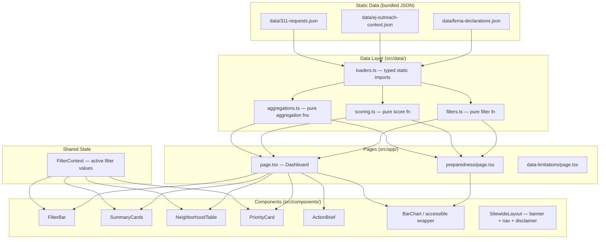

# Design Document

## Overview

CivicPulse is a static, offline-capable civic dashboard built with Next.js App Router and TypeScript. It surfaces repeated Boston 311 service request patterns, ranks neighborhood–service-topic combinations by an explainable priority score, and provides structured Action Briefs to guide human review. All data is loaded from local JSON files bundled with the application; no runtime network requests are made.

The application targets city operations staff, community organizations, and residents. It does not make enforcement, benefit, emergency, or eligibility decisions. Every visualization carries a source citation, a snapshot date, and a limitations statement.

### Key Design Decisions

| Decision | Choice | Rationale |
|---|---|---|
| Rendering strategy | Static export (`output: 'export'`) | Guarantees offline operation; no server required for hackathon demo |
| Data loading | Static `import` at module level | Zero runtime fetch; TypeScript type-checks the schema at compile time |
| Charting library | Recharts (MIT) | First-class React integration, built-in ARIA support, easy to pair with accessible summary tables |
| Priority score | Pure TypeScript function, four weighted inputs | Deterministic, testable, no side effects; weights are visible in UI |
| State management | React `useState` / `useReducer` in a single filter context | Sufficient for a local data set; avoids unnecessary complexity |
| CSS framework | Tailwind CSS v3 utility classes | Rapid responsive layout; consistent color palette with WCAG-AA contrast enforcement |
| Map | **None** | Requirements explicitly prohibit implying an exact EJ-to-neighborhood geographic match |

---

## Architecture



### Rendering Strategy

All pages use Next.js static export (`next.config.ts` sets `output: 'export'`). Data is imported directly as typed JSON modules — no `fetch()` calls exist anywhere in the codebase. This guarantees full offline operation.

```
next build  →  /out/  (static HTML + JS + assets)
```

The build output can be served by any static file server or opened directly as a file, satisfying the hackathon offline-demo requirement.

---

## Components and Interfaces

### SitewideLayout

Wraps every page. Renders:

- **Sitewide banner** (sticky top): "CivicPulse is not an official City of Boston service."
- **Navigation** links to Dashboard, Preparedness, and Data & Limitations.
- **Per-page disclaimer** slot (passed as a prop): "CivicPulse does not make enforcement, benefit, emergency, or eligibility decisions."
- **Footer** with MA_211 link, data source links, and snapshot date.

All external links use `target="_blank" rel="noopener noreferrer"` and carry descriptive `aria-label` text.

### FilterBar

```typescript
interface FilterState {
  neighborhoods: string[];      // empty = all
  serviceTopics: string[];      // empty = all
  departments:   string[];      // empty = all
  caseStatus:    'open' | 'closed' | 'all';
  startDate:     string | null; // ISO 8601 date
  endDate:       string | null;
}
```

- Multi-select dropdowns for neighborhoods, service topics, departments.
- Radio group for case status.
- Date inputs for time period.
- Each control is a native `<select>` or `<input>` with an explicit `<label>`.
- A "Clear all filters" button resets to the default `FilterState`.
- On change, updates `FilterContext`; all downstream components re-derive from the new filter state.

### SummaryCards

Displays four aggregate statistics derived from filtered records:

- Total 311 requests in view
- Open cases
- Unique neighborhoods represented
- Unique service topics represented

Each card is a `<article>` with an `aria-label`.

### NeighborhoodTable

A `<table>` listing every known neighborhood with its filtered 311 request count, even when the count is zero. Columns: Neighborhood, Total Requests, Open Cases, Top Service Topic.

Includes a `<caption>` with source attribution and snapshot date. Supports keyboard sorting via column header `<button>` elements.

### PriorityCard

```typescript
interface PriorityCardProps {
  neighborhood:    string;
  serviceTopic:    string;
  score:           number;           // 0–100
  openPressure:    number;           // 0–1 normalised
  repeatedPressure: number;          // 0–1 normalised
  onTimePressure:  number;           // 0–1 normalised (inverse on-time rate)
  outreachFlag:    boolean;
  plainExplanation: string;
  actionBrief:     ActionBrief;
}
```

- Displays score prominently with an accessible colour-blind-safe colour scale (uses pattern + text in addition to colour).
- Displays all four score component values as labelled progress bars with numeric annotations.
- The `outreachFlag` row always carries the label: *"Aggregate outreach context — this flag represents neighborhood-level data and does not profile individual residents."*
- Expandable section for the ActionBrief (toggle button, `aria-expanded`).
- The plain-language explanation uses no statistical jargon.

### ActionBrief

```typescript
interface ActionBrief {
  whatDataShows:     string;  // description of the pattern
  whyReviewWarranted: string; // derived from score components
  dataSource:        string;  // "Boston 311 Open Data (sample)"
  snapshotDate:      string;  // ISO 8601 date
  limitations:       string;  // standard disclaimer
}
```

The `limitations` field always includes: *"Sample data is for demonstration purposes only. CivicPulse is not an official City of Boston service and does not make enforcement, benefit, emergency, or eligibility decisions."*

The `whyReviewWarranted` field must not recommend a specific enforcement or eligibility action.

### AccessibleChart

A thin wrapper around a Recharts `BarChart` or `LineChart` that:

1. Renders a visible `<figcaption>` with source label and limitations note.
2. Renders a visually hidden `<table>` (`sr-only` class) as the ARIA text alternative, containing the same data as the chart.
3. Adds `role="img"` and `aria-label` to the chart SVG container.
4. Does not use colour as the sole distinguishing indicator — bar fills also use labelled patterns via SVG `<defs>`.
5. Wraps the whole block in `<figure>`.

### Preparedness Page Components

- **FemaDeclarationList**: A `<table>` of historical FEMA Massachusetts disaster declarations.
- Prominent notice at top of page (visually distinct `<aside role="note">`): *"FEMA data shown here is historical context only. This is not a live emergency alert or current risk assessment."*
- Source citation and snapshot date on every data element.
- No external network requests; data loaded from `data/fema-declarations.json`.

### Data & Limitations Page

A static content page documenting:
- What Sample_Data contains and does not contain.
- Snapshot date and provenance of each data set.
- Link to Boston 311 official data source.
- Link to FEMA disaster declarations official source.
- Link to MA_211.
- Explanation of the outreach context flag and what it does and does not represent.

---

## Data Models

### 311Request

```typescript
interface Request311 {
  caseId:          string;
  serviceTopic:    string;       // e.g. "Pothole", "Rodent Activity"
  neighborhood:    string;       // e.g. "Roxbury", "Dorchester"
  department:      string;       // e.g. "Public Works"
  status:          'open' | 'closed';
  submittedDate:   string;       // ISO 8601 date
  closedDate:      string | null; // null if still open
  onTimeResolution: boolean | null; // null if open
}
```

### EJOutreachContext

```typescript
interface EJOutreachContext {
  neighborhood:    string;
  hasOutreachFlag: boolean; // true = outreach data associated with this neighborhood
  note:            string;  // explains the aggregate nature of the flag
}
```

### FemaDeclaration

```typescript
interface FemaDeclaration {
  declarationNumber: string;
  disasterType:      string;
  declarationDate:   string; // ISO 8601 date
  state:             string;
  county:            string | null;
  programsActivated: string[];
}
```

### Sample Data Files

| File | Description | Row count (demo) |
|---|---|---|
| `data/311-requests.json` | Synthetic 311 service requests for Boston neighborhoods | ~500 records |
| `data/ej-outreach-context.json` | Binary outreach flag per neighborhood | ~25 records (one per neighborhood) |
| `data/fema-declarations.json` | Historical FEMA MA disaster declarations | ~50 records |

Each file includes a top-level `meta` object:

```typescript
interface DataFileMeta {
  snapshotDate:  string; // ISO 8601 date
  source:        string; // human-readable source description
  officialUrl:   string; // link to official data source
  limitations:   string; // demo disclaimer
}
```

### Computed Types

```typescript
interface NeighborhoodAggregate {
  neighborhood:   string;
  totalCount:     number;
  openCount:      number;
  topServiceTopic: string | null;
}

interface GroupKey {
  neighborhood: string;
  serviceTopic: string;
}

interface ScoreInputs {
  openCasePressure:     number; // 0–1
  repeatedPressure:     number; // 0–1
  onTimePressure:       number; // 0–1 (1 − on-time rate)
  outreachContextFlag:  0 | 1;
}

interface ScoreResult {
  score:            number; // 0–100
  inputs:           ScoreInputs;
  normalizedInputs: ScoreInputs;
}
```

---

## Priority Score: Formula and Weight Rationale

### Score Function Signature

```typescript
function computePriorityScore(inputs: ScoreInputs): ScoreResult
```

The function is **pure**: same inputs always produce the same output; no I/O, no mutation, no randomness.

### Formula

```
Score = clamp(
  W_open   * openCasePressure
+ W_repeat * repeatedPressure
+ W_ontime * onTimePressure
+ W_flag   * outreachContextFlag
, 0, 100
)
```

### Weights

| Component | Weight | Rationale |
|---|---|---|
| `openCasePressure` | 35 | Unresolved open cases represent current service demand; this is the most direct indicator of immediate need |
| `repeatedPressure` | 30 | Persistent repeat requests in the same area suggest a systemic pattern rather than a one-off event |
| `onTimePressure` | 25 | A low on-time resolution rate (high pressure value) indicates service-level failure, which compounds community impact |
| `outreachContextFlag` | 10 | The flag provides aggregate neighborhood outreach context; it is a binary modifier, not a primary driver, to avoid profiling |

The four weights sum to 100. Each component is pre-normalised to the range [0, 1] before multiplication, so the raw score is already in [0, 100]. `clamp` guards against floating-point edge cases.

### Normalisation Rules

- **openCasePressure**: `openCount / max(openCount across all groups in view, 1)`
- **repeatedPressure**: `groupCount / max(groupCount across all groups, 1)`
- **onTimePressure**: `1 − (onTimeClosedCount / max(closedCount, 1))`  
  (If no closed cases exist, pressure defaults to 0 — absence of evidence is not evidence of failure)
- **outreachContextFlag**: `1` if `EJOutreachContext.hasOutreachFlag === true`, else `0`

Normalisation is performed in a separate pure function `normalizeScoreInputs(raw: RawScoreInputs, maxima: Maxima): ScoreInputs` so the score function itself only ever receives pre-normalised values.

### Displayed Values

Every Priority_Card displays the **normalised** value for each component (as a fraction or percentage) alongside the raw count, so reviewers can see both the relative weight and the underlying number.

---

## Correctness Properties

*A property is a characteristic or behavior that should hold true across all valid executions of a system — essentially, a formal statement about what the system should do. Properties serve as the bridge between human-readable specifications and machine-verifiable correctness guarantees.*

### Property 1: Aggregation Correctness

*For any* non-empty array of `Request311` records, the output of `aggregateByNeighborhood(records)` must satisfy two conditions simultaneously: (a) every distinct `neighborhood` value present in `records` appears as a key in the result, and (b) the sum of all per-neighborhood counts equals `records.length`. When a filter is applied that excludes all records for a specific neighborhood, that neighborhood must still appear in the result with a count of zero (the full neighborhood list is drawn from the master neighborhood list, not from the filtered records alone).

**Validates: Requirements 1.1, 1.3, 1.4**

### Property 2: Filter Completeness

*For any* array of `Request311` records and any `FilterState`, every record returned by `applyFilters(records, filters)` must individually satisfy all active filter criteria, and no record that satisfies all active filter criteria may be absent from the result. When all filter dimensions are in their default (unset) state, `applyFilters(records, defaultFilters)` must return a result with the same length as the input.

**Validates: Requirements 2.6, 2.7**

### Property 3: Score Determinism and Boundedness

*For any* `ScoreInputs` value where each normalised input is in the range [0, 1] and `outreachContextFlag` is 0 or 1, `computePriorityScore(inputs).score` must always be a finite number in the closed interval [0, 100], and calling the function twice with the same inputs must return the same score. Additionally, holding all other inputs constant, a score computed with `outreachContextFlag = 1` must be exactly 10 points higher than a score computed with `outreachContextFlag = 0` (reflecting the weight of the flag component).

**Validates: Requirements 3.2, 3.4, 3.5, 3.6, 3.7**

### Property 4: Priority Card Sort Order

*For any* array of `PriorityCard` data objects, the output of `sortByScore(cards)` must be non-increasing in `score` — that is, for every adjacent pair `(cards[i], cards[i+1])` in the sorted result, `cards[i].score >= cards[i+1].score`.

**Validates: Requirements 3.3**

---

## Error Handling

### Data Loading Errors

Since data is loaded via static `import`, TypeScript schema validation at build time is the first line of defense. At runtime, each loader validates the imported JSON against a Zod schema; if validation fails (malformed sample data), the application renders a `DataError` component with a human-readable message rather than crashing.

### Empty States

Every data-dependent component defines an explicit empty state:

| Component | Empty condition | Display |
|---|---|---|
| NeighborhoodTable | All neighborhoods have zero records after filtering | "No 311 requests match the current filters. Try adjusting your filter criteria." |
| PriorityCard list | No (neighborhood, service_topic) pairs in filtered data | "No priority data to display. Adjust your filters to see priority cards." |
| FemaDeclarationList | Sample data contains zero declarations | "No FEMA declarations found in sample data." |
| AccessibleChart | No data points | Chart replaced by a text notice; `<figure>` retains its `<figcaption>` with source and limitations |

### Loading States

Because data is statically imported, there is no true async loading step for core data. However, React `Suspense` boundaries are placed around heavy chart components to handle code-splitting and deferred rendering gracefully. A `LoadingSpinner` component with `aria-busy="true"` and a visible label is shown within each boundary.

### Filter-Produces-No-Results

When `applyFilters` returns an empty array, a top-level `EmptyState` banner is shown across the full data area, satisfying Requirement 2.8.

### Network Unavailability

The application contains no `fetch()` calls to external URLs. The only external links are plain `<a>` elements that open in new tabs. No error handling for network failure is required for data loading.

---

## Testing Strategy

### Dual Approach

Testing uses both example-based unit tests and property-based tests. Unit tests verify specific scenarios, edge cases, and UI structure. Property-based tests verify universal correctness across wide input ranges.

**Frameworks**:
- Unit tests: [Vitest](https://vitest.dev/) with [React Testing Library](https://testing-library.com/docs/react-testing-library/intro/)
- Property-based tests: [fast-check](https://fast-check.dev/) (MIT, actively maintained), configured with minimum 100 iterations per property

**Test file locations**:
- `src/data/__tests__/aggregations.test.ts` — Property tests for aggregation and filter functions
- `src/data/__tests__/scoring.test.ts` — Property tests for score computation
- `src/components/__tests__/` — Example-based unit tests for UI components
- `src/app/__tests__/` — Page-level integration tests

### Property-Based Tests

Each property test references its design document property via a comment tag.

**Property 1 — Aggregation Correctness**
```typescript
// Feature: civicpulse, Property 1: aggregation correctness
fc.assert(fc.property(
  fc.array(arbRequest311, { minLength: 1 }),
  (records) => {
    const result = aggregateByNeighborhood(records, ALL_NEIGHBORHOODS);
    const totalCount = Object.values(result).reduce((a, b) => a + b.totalCount, 0);
    return (
      totalCount === records.length &&
      ALL_NEIGHBORHOODS.every(n => n in result)
    );
  }
), { numRuns: 100 });
```

**Property 2 — Filter Completeness**
```typescript
// Feature: civicpulse, Property 2: filter completeness
fc.assert(fc.property(
  fc.array(arbRequest311),
  arbFilterState,
  (records, filters) => {
    const result = applyFilters(records, filters);
    return result.every(r => matchesFilter(r, filters));
  }
), { numRuns: 100 });
```

**Property 3 — Score Determinism and Boundedness**
```typescript
// Feature: civicpulse, Property 3: score determinism and boundedness
fc.assert(fc.property(
  arbScoreInputs,
  (inputs) => {
    const s1 = computePriorityScore(inputs).score;
    const s2 = computePriorityScore(inputs).score;
    const flagDelta =
      computePriorityScore({ ...inputs, outreachContextFlag: 1 }).score -
      computePriorityScore({ ...inputs, outreachContextFlag: 0 }).score;
    return s1 === s2 && s1 >= 0 && s1 <= 100 && Math.abs(flagDelta - 10) < 0.001;
  }
), { numRuns: 100 });
```

**Property 4 — Priority Card Sort Order**
```typescript
// Feature: civicpulse, Property 4: priority card sort order
fc.assert(fc.property(
  fc.array(arbPriorityCardData, { minLength: 2 }),
  (cards) => {
    const sorted = sortByScore(cards);
    return sorted.every((c, i) =>
      i === 0 || sorted[i - 1].score >= c.score
    );
  }
), { numRuns: 100 });
```

### Example-Based Unit Tests

Unit tests cover:

- **Presence tests**: Filter controls render with correct `<label>` associations; each Priority_Card renders all four component values; ActionBrief renders all required fields (source, date, limitations, no-decision statement).
- **Outreach flag label**: When `outreachFlag` is true, the card renders the aggregate-data disclaimer text.
- **Empty state messages**: Correct messages appear when filter produces zero results or no data is available.
- **External links**: All external `<a>` tags have `target="_blank"`, `rel="noopener noreferrer"`, and descriptive text (not "click here").
- **Accessibility structure**: Charts render a `<table>` with `class="sr-only"` containing the same data; chart SVG has `role="img"` and `aria-label`; each chart `<figure>` has a `<figcaption>`.
- **FEMA page disclaimer**: Preparedness page renders the historical-context-only notice prominently.
- **No enforcement language**: ActionBrief text does not match a list of forbidden enforcement/eligibility phrases.

### Accessibility Testing

- Automated: [axe-core](https://github.com/dequelabs/axe-core) via `@axe-core/react` in development and in CI via `vitest-axe`.
- Manual: Keyboard-only navigation walkthrough; screen reader smoke test with VoiceOver/NVDA.
- Color contrast: Enforced via Tailwind's configured palette; verified with [Colour Contrast Analyser](https://www.tpgi.com/color-contrast-checker/) during design review.

### Running Tests

```bash
# Single run (CI-safe, no watch mode)
npx vitest run

# With coverage
npx vitest run --coverage
```
